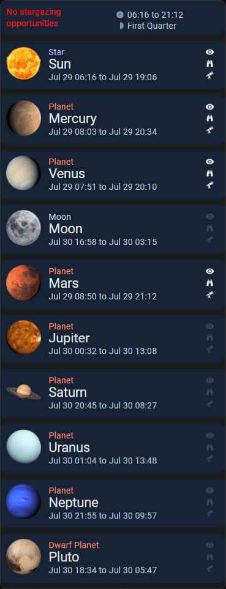

<h1 align="center">Sky Tonight Card</h1>

<p align="center">
  A Home Assistant dashboard card showing what's in the sky tonight — sun, moon, and planet
  visibility, plus upcoming eclipses, celestial events, and meteor showers for your location.
  Powered by <a href="https://github.com/cosinekitty/astronomy">Astronomy Engine</a>.
</p>

<p align="center">
  <a href="https://github.com/wwwescape/sky-tonight-card/releases"></a>
  <a href="https://github.com/wwwescape/sky-tonight-card/commits/main"></a>
  <a href="https://github.com/wwwescape/sky-tonight-card"></a>
  <a href="https://hacs.xyz/docs/faq/custom_repositories/"></a>
</p>

## Screenshots



## Features

- **Solar System** — rise and set times, visibility duration, and altitude for the Sun, Moon,
  Mercury, Venus, Mars, Jupiter, Saturn, Uranus, and Neptune, plus the current moon phase.
- **Visibility indicators** — whether each object is visible to the naked eye, with binoculars,
  or with a telescope.
- **Eclipses** — upcoming lunar eclipses and solar eclipses visible from your location, with
  kind, obscuration, duration, and peak time.
- **Celestial events** — equinoxes and solstices, planetary oppositions, greatest elongations
  of Mercury and Venus, and supermoons.
- **Meteor showers** — the 13 major annual showers, with their zenith hourly rate (ZHR), status,
  and a peak viewing time worked out for your location.
- **Tabbed layout** — Solar System, Eclipses, Celestial Events, and Meteor Showers tabs, each
  showing up to 10 entries, looking about 18 months ahead.
- **Customizable** — title, location, which objects and tabs to show, and every card color,
  all from the visual editor or YAML.
- **Languages** — English, French, German, Hindi, and Italian, following your Home Assistant
  language by default.

## Installation

### HACS (recommended)

1. Open HACS, click the ⋮ menu in the top right corner, and choose **Custom repositories**.
2. Paste `https://github.com/wwwescape/sky-tonight-card`, choose **Dashboard** as the type, and
   click **Add**.
3. Search for **Sky Tonight Card**, click the ⋮ menu next to it, and choose **Download**.
4. Refresh your browser.

### Manual

1. Download [sky-tonight-card.js](https://github.com/wwwescape/sky-tonight-card/releases/latest/download/sky-tonight-card.js)
   and place it in `<config>/www/sky-tonight-card/`.
2. Add it as a dashboard resource: go to **Settings → Dashboards → ⋮ → Resources → Add
   Resource**, enter `/local/sky-tonight-card/sky-tonight-card.js` as the URL, and choose
   **JavaScript Module**. Or, in YAML mode, add it to `configuration.yaml`:

   ```yaml
   lovelace:
     resources:
       - url: /local/sky-tonight-card/sky-tonight-card.js
         type: module
   ```

3. Refresh your browser.

## Configuration

Add the card from the dashboard editor (search for **Sky Tonight Card**) and set everything in
the visual editor, or configure it in YAML:

| Name                  | Type    | Default              | Description                                                                 |
| --------------------- | ------- | -------------------- | --------------------------------------------------------------------------- |
| `type`                | string  | **Required**         | `custom:sky-tonight-card`                                                   |
| `cardTitle`           | string  | `Sky Tonight`        | Title of the card                                                           |
| `lat`                 | number  | Home Assistant value | Observer latitude                                                           |
| `lon`                 | number  | Home Assistant value | Observer longitude                                                          |
| `elev`                | number  | `0`                  | Observer elevation, in metres above sea level                               |
| `languageOverride`    | string  | Home Assistant value | Card language: `en`, `fr`, `de`, `hi`, or `it`                              |
| `showSun`             | boolean | `true`               | Show the Sun                                                                |
| `showBelowHorizon`    | boolean | `false`              | Also show objects that are currently below the horizon                      |
| `showConfiguration`   | boolean | `false`              | Show the latitude/longitude/elevation block (the visual editor turns it on) |
| `showEclipses`        | boolean | `true`               | Show the Eclipses tab                                                       |
| `showCelestialEvents` | boolean | `true`               | Show the Celestial Events tab                                               |
| `showMeteorShowers`   | boolean | `true`               | Show the Meteor Showers tab                                                 |
| `colors`              | object  |                      | Color overrides — see [Colors](#colors)                                     |

### Colors

| Property           | Default   | Description                                 |
| ------------------ | --------- | ------------------------------------------- |
| `cardBackground`   | `#1b2431` | Background color of the card                |
| `cardTitle`        | `#ffffff` | Color of the card title                     |
| `objectBackground` | `#223044` | Background color of each object's container |
| `objectName`       | `#ffffff` | Color of each object's name                 |
| `objectData`       | `#cccccc` | Color of each object's data                 |
| `objectType`       | `#aaaaaa` | Color of each object's type                 |

### Example

```yaml
type: custom:sky-tonight-card
cardTitle: Objects in the sky
lat: 40.7128
lon: -74.0060
elev: 10
showSun: true
showBelowHorizon: false
showConfiguration: true
showEclipses: true
showCelestialEvents: true
showMeteorShowers: true
colors:
  cardBackground: "#1b2431"
  cardTitle: "#ffffff"
```

## Adding Translations

1. Copy `translation-template.ts` to `src/translations/<lang-code>.ts`.
2. Fill in every string.
3. Register the language in `src/translations/index.ts`.
4. Open a pull request.

## Development

```bash
git clone https://github.com/wwwescape/sky-tonight-card.git
cd sky-tonight-card
npm ci
npm run build
```

The build writes `dist/sky-tonight-card.js`. Pushing a version tag (e.g. `git tag v1.4.0 && git push origin v1.4.0`) builds the card and publishes it to a new GitHub Release.

## License

MIT — see [LICENSE](LICENSE).

## Support

If you find Sky Tonight Card useful, consider buying me a coffee:

[](https://buymeacoffee.com/wwwescape)
